&nbsp;
&nbsp;
&nbsp;

 

I'm Muhammad Rashid, a computer science senior at Drexel University in Philadelphia, graduating June 2027. I build systems: protocol servers, data pipelines, and the guardrails that sit between an AI agent and the thing it wants to do.

Right now I'm building a Redis clone in C and a distributed key-value store with Raft in Python, pushing real work every day. I also run [Cureon](https://cureonhealth.org), a Philadelphia community connecting healthcare workers with engineers, and I'm president of DragonHacks at Drexel IEEE.

I'm looking for 2027 new grad software engineering roles anywhere in the US.

## 📊 Stats

## 🔥 Now building

<table>
<tr>
<td width="50%" valign="top">

### [cinder](https://github.com/muhammadrashid4587/cinder)

**A Redis-compatible key-value store, in C, no dependencies.**

Single-threaded `poll()` event loop, RESP protocol, chained hash table with TTLs, approximate LRU eviction, and an append-only log with fsync-always durability that survives a restart.

`~25k SET/s` · `~34k GET/s` · `30+ smoke tests` · `AOF restart test`

`C` `RESP` `systems`

</td>
<td width="50%" valign="top">

### [raftkv](https://github.com/muhammadrashid4587/raftkv)

**A distributed key-value store with Raft consensus, in pure Python.**

Leader election with randomized timeouts, durable fsynced log, leader-confirmed reads so a partitioned ex-leader can't serve stale data, follower redirects.

`8/8 tests` · `3-node cluster` · `kill the leader, writes continue`

`Python` `Raft` `distributed systems`

</td>
</tr>
</table>

## 📦 Shipped before

<table>
<tr>
<td width="50%" valign="top">

### [mcp-schema-sentinel](https://github.com/muhammadrashid4587/mcp-schema-sentinel)

A read-only MCP server Claude and Cursor can't be talked into writing with. JSON-RPC 2.0 stdio from scratch, no SDK. The SQL guard is an allowlist, not a blocklist.

`165 tests` · `31 bypass techniques blocked` · `p50 0.16 ms/call`

`Python` `MCP` `JSON-RPC` `SQLite`

</td>
<td width="50%" valign="top">

### [aws-docforge](https://github.com/muhammadrashid4587/aws-docforge)

S3 → SQS → Lambda → Bedrock document pipeline that runs with no AWS account. PII redaction happens *before* the model call, enforced by an assertion. IAM least-privilege is checked by tests, not claimed in a README.

`77 tests` · `SAM + Terraform` · `zero-credential demo`

`AWS` `Lambda` `Terraform` `Bedrock` `moto`

</td>
</tr>
<tr>
<td width="50%" valign="top">

### [toolshield](https://github.com/muhammadrashid4587/toolshield)

Guardrails between an agent deciding to act and acting. Schema, path containment, command risk, indirect prompt-injection detection. Ambiguous actions go to a human instead of being forced into allow or deny.

`185 tests` · `precision 1.000 / recall 0.950` · `79-doc corpus`

`Python` `AI security` `prompt injection`

</td>
<td width="50%" valign="top">

### [lab](https://github.com/muhammadrashid4587/lab)

A daily practice that refuses to fake a commit. Five layered checks block date spoofing, headless runs, placeholder notes, and empty diffs. An AST test proves no git call site can pass `--allow-empty` or `--date`.

`34 tests` · `no contribution bots` · `12-week plan as code`

`Python` `tooling` `git`

</td>
</tr>
</table>

## 💼 Experience

- **CSL Behring** — Project Management Co-op, Plasma Project Delivery, Mar–Aug 2026. Migrated 122 product requirements from Confluence to Excel and analyzed a 174-item Smartsheet register.
- **TechTunes** — Full-Stack Developer, Jul 2025–Feb 2026. Built a React + FastAPI music platform and shipped the beta on Vercel with sub-100ms loads.
- **Zen Music Group** — Software Developer, Mar 2025–Sep 2025. Built an async video pipeline with FastAPI + FFmpeg that cut storage costs 60% and API errors 75%, with Vertex AI Gemini metadata extraction.
- **Brown Brothers Harriman** — Enterprise Architecture Co-op, Apr–Sep 2024. Python ETL and an Azure OpenAI data visualization chatbot that saved 15+ hours a week and cut manual workload 50%.

## 🛠 Stack

Things I'd be comfortable being interviewed on, not everything I've touched.

## 🤝 Open source contributions

Patches to other people's codebases — reading unfamiliar code, matching its conventions, and getting a change through review.

| Repo | What I did | PR | Status |
|------|-----------|-----|--------|
| `aden-hive/hive` | Graph validation for edge IDs, self-loops, and conditions | [#6154](https://github.com/aden-hive/hive/pull/6154) | Closed |
| `Gustav-Proxi/agentreplay` | Single-node + stats API endpoints, with tests | [#17](https://github.com/Gustav-Proxi/agentreplay/pull/17) | Open |
| `wook95/ngx-recharts` | Fixed shape components, unified polar angle math | [#16](https://github.com/wook95/ngx-recharts/pull/16) | Closed |
| `ioflux-org/studio-json-schema` | YAML node-click highlighting in the Monaco editor | [#176](https://github.com/ioflux-org/studio-json-schema/pull/176) | Closed |
| `RetricSu/fiber-pay` | Replaced blocking `appendFileSync` with an async `WriteStream` | [#75](https://github.com/RetricSu/fiber-pay/pull/75) | Closed |
| `msutara/config-manager-web` | Fixed hidden job history on fresh installs | [#42](https://github.com/msutara/config-manager-web/pull/42) | Closed |

## 🌱 Also building

- **Cureon** — founder. A Philadelphia community connecting healthcare workers with engineers. Speaking at CureHacks, Jan 9–10, 2027.
- **DragonHacks** — president, Drexel IEEE. 500 hackers, Jan 16–17, 2027.
- **GeneSight** — Philly CodeFest 2025 winner, CSL Plasma Heroes Award. XGBoost genomic classification, 89% accuracy, FastAPI + React, 10,000+ samples.
- **DroneDash** — OwlHacks 2025 winner. WebRTC + React + TypeScript + FastAPI.
- **MORPH** — gesture-controlled robot, OpenCV + MediaPipe.
- **RW Tracker** — Kotlin app processing ~200 Hz sensor data with under 50 ms latency. CCI Senior Design Honorable Mention.
- **The Foundry** — co-founder. A community for student builders and young founders.

If you're hiring for 2027 new grad roles, or want to talk systems, healthcare tech, or hackathons — my inbox is open.

