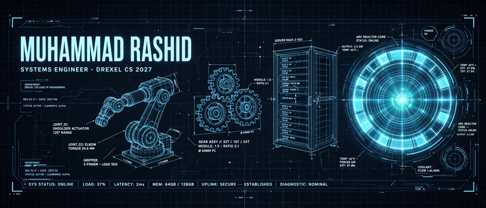

<p align="center">

</p>

<p align="center">
<a href="https://linkedin.com/in/muhammad-rashid3662"></a>&nbsp;
<a href="https://www.muhammadrashid.space"></a>&nbsp;
<a href="mailto:muhdrashid3662@gmail.com"></a>
</p>

```
// SYSTEM STATUS
> OPERATOR      : MUHAMMAD RASHID
> ROLE          : SYSTEMS ENGINEER — DREXEL CS '27
> LOCATION      : PHILADELPHIA, PA
> AVAILABILITY  : OPEN — 2027 NEW GRAD ROLES, US-WIDE
> WORK AUTH     : OPT FROM JUN 2027
> CURRENT OPS   : REDIS CLONE IN C // RAFT KV IN PYTHON // DAILY COMMITS
```

## // TELEMETRY

<p align="center">


</p>

<p align="center">

</p>

<p align="center">

</p>

<p align="center">

</p>

## // ACTIVE BUILDS

### [cinder](https://github.com/muhammadrashid4587/cinder) — REDIS-CLONE // C

```
ARCH       : single-threaded poll() loop · RESP · chained hash table + TTLs
             approximate LRU eviction · append-only log, fsync-always
THROUGHPUT : ~25k SET/s · ~34k GET/s (sequential, dev VM)
TESTS      : 30+ RESP smoke checks · AOF restart test — data survives SHUTDOWN
STATUS     : LIVE — v0.1.0
```

### [raftkv](https://github.com/muhammadrashid4587/raftkv) — DISTRIBUTED KV // RAFT // PYTHON

```
ARCH       : leader election, randomized timeouts · RequestVote / AppendEntries
             durable fsynced log · leader-confirmed reads · follower redirects
VERIFIED   : 3-node cluster — kill the leader, survivors re-elect, writes continue,
             old leader rejoins and catches up
TESTS      : 8/8 passing
STATUS     : LIVE — v0.1.0
```

## // DEPLOYED

```
mcp-schema-sentinel  : read-only MCP server, JSON-RPC from scratch, SQL allowlist guard
                       165 tests · 31 bypass techniques blocked · p50 0.16 ms/call
aws-docforge         : S3 → SQS → Lambda → Bedrock pipeline, no AWS account needed
                       PII redacted before the model call · 77 tests · SAM + Terraform
toolshield           : guardrails between an agent deciding and acting
                       185 tests · precision 1.000 / recall 0.950 · 79-doc corpus
lab                  : daily practice that refuses to fake a commit
                       34 tests · no contribution bots · date-spoofing blocked
```

## // FIELD RECORD

```
CSL BEHRING      : Project Mgmt Co-op, Plasma — Mar–Aug 2026
                   122 requirements migrated Confluence → Excel · 174-item register
TECHTUNES         : Full-Stack Dev — Jul 2025–Feb 2026
                   React + FastAPI music platform · beta on Vercel · sub-100ms loads
ZEN MUSIC GROUP   : Software Dev — Mar–Sep 2025
                   async video pipeline · storage −60% · API errors −75% · Vertex AI Gemini
BROWN BROS HARRIMAN: Enterprise Architecture Co-op — Apr–Sep 2024
                   Python ETL · Azure OpenAI chatbot · 15+ hrs/week saved · manual work −50%
```

## // TOOLING

<p align="center">

</p>

## // OPEN SOURCE

| REPO | CHANGE | PR | STATUS |
|------|--------|-----|--------|
| `aden-hive/hive` | Graph validation for edge IDs, self-loops, conditions | [#6154](https://github.com/aden-hive/hive/pull/6154) | Closed |
| `Gustav-Proxi/agentreplay` | Single-node + stats API endpoints, with tests | [#17](https://github.com/Gustav-Proxi/agentreplay/pull/17) | Open |
| `wook95/ngx-recharts` | Fixed shape components, unified polar angle math | [#16](https://github.com/wook95/ngx-recharts/pull/16) | Closed |
| `ioflux-org/studio-json-schema` | YAML node-click highlighting in Monaco editor | [#176](https://github.com/ioflux-org/studio-json-schema/pull/176) | Closed |
| `RetricSu/fiber-pay` | Replaced blocking `appendFileSync` with async `WriteStream` | [#75](https://github.com/RetricSu/fiber-pay/pull/75) | Closed |
| `msutara/config-manager-web` | Fixed hidden job history on fresh installs | [#42](https://github.com/msutara/config-manager-web/pull/42) | Closed |

## // SIDE SYSTEMS

```
CUREON        : founder — Philadelphia community, healthcare workers + engineers
                speaking at CureHacks, Jan 9–10 2027
DRAGONHACKS   : president, Drexel IEEE — 500 hackers, Jan 16–17 2027
GENESIGHT     : Philly CodeFest 2025 winner — XGBoost genomics, 89% accuracy, 10k+ samples
DRONEDASH     : OwlHacks 2025 winner — WebRTC + React + TS + FastAPI
MORPH         : gesture-controlled robot — OpenCV + MediaPipe
RW TRACKER    : Kotlin — ~200 Hz sensor data, <50 ms latency
THE FOUNDRY   : co-founder — community for student builders and young founders
```

```
// STATUS: OPEN TO 2027 NEW GRAD ROLES
// CONTACT: muhdrashid3662@gmail.com
```
